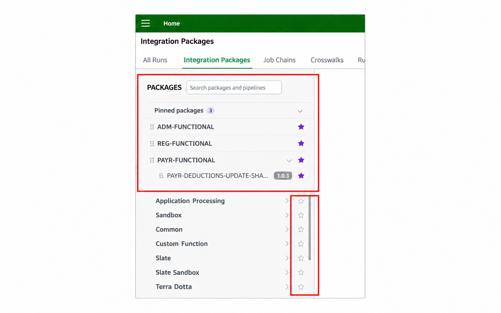
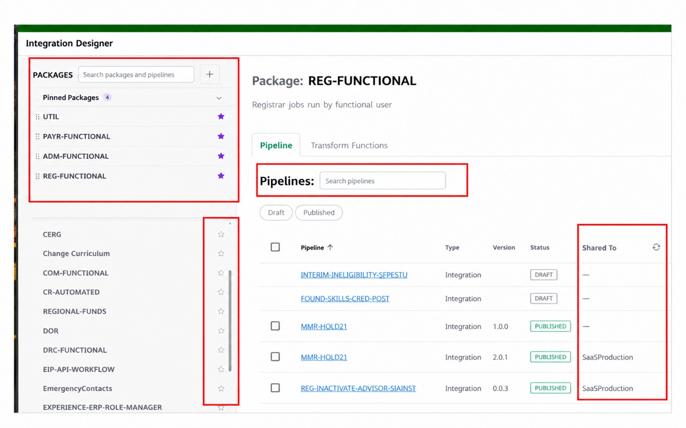
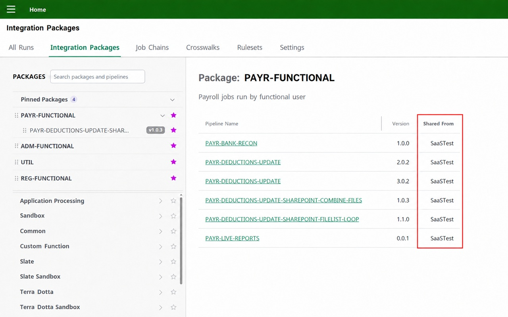

# Integration Navigator

> **v2 test candidate (2.0.9):** package headings show selected type counts without changing the expanded lists. Download ZIP now builds and starts the download in one click, with Download Again available afterward. Every published Pipeline/Sub-Pipeline major and transformer `.js` exports remain included. Signed-in confirmation is still required. See [v2 Development](docs/V2-Development.md). This is not the store release.

For extension code updates, contributors follow [AGENTS.md](AGENTS.md) for delivered versions, docs/CHANGELOG.md, inline comments, and evidence-backed `Keep:` tags.

Make Ellucian Integration Packages and Integration Designer easier to navigate in Chrome and Microsoft Edge.

## What It Does

- Scroll and resize the package sidebar independently of the main page.
- Search package and pipeline names, even with different spacing or separators.
- Pin packages and published pipelines, then drag favorites into your preferred order.
- Automatically fit pipeline-name columns, with manual resizing when needed.
- Optionally show the latest published APIs and Sub-Pipelines as read-only main-table records with a **Type** column, independently of Shared From.
- Optionally show **Shared To** in Designer, highlighting version mismatches in red.
- Optionally scroll, select, and copy published fitting text/code in Designer while editing stays locked.
- Optionally show **Shared From** in Integration Packages using locally saved Designer sources.
- Customize your toolbar icon, favorite shapes and colors, and search display.

Favorites stay separate by site, tenant ID, and Packages/Designer page, including multiple tenants behind one vanity domain. Export JSON backs up favorites and saved sources; Backup & Restore lets you preview and import them. Standard Experience Test and Production sites are supported, along with university vanity URLs you add in settings.

Existing favorites carry over automatically when only one tenant is known on that domain. If multiple tenants are known, settings lets you choose which one owns the old list.

Verified duplicate recovery copies are cleaned up automatically; unresolved copies stay saved. Backups retain small assignment markers so older files cannot automatically bring back removed pins.

## Install

[Install from the Chrome Web Store](https://chromewebstore.google.com/detail/integration-navigator/dbmjmmgocklhjnadhmibaldicbgoignd). The same listing works in Chrome and Edge; Edge may ask you to allow extensions from other stores.

You need an institution-provided Ellucian account with access to the supported pages. The extension does not provide access or change packages or pipelines.

Open the extension's toolbar icon to adjust its settings. Store-installed copies receive updates through the browser; [manual installation and update instructions](docs/User-Guide.md#manual-installation) are in the user guide.

## Screenshots

**Pinned Packages:** keep favorite packages and pipelines within reach.



**Integration Designer:** search pipelines in the selected package and see shared destinations.



**Shared From:** see locally remembered Designer sources in Integration Packages.



**Settings:** choose page behavior, search display, icon and favorite colors, and custom sites.


Package and pipeline names in these screenshots are anonymized.

## Help and Documentation

- [User Guide](docs/User-Guide.md): settings, favorites, sharing columns, and installation.
- [Troubleshooting](docs/Troubleshooting.md): updates, page loading, and missing sharing information.
- [Changelog](docs/CHANGELOG.md): version history.
- [Privacy Policy](PRIVACY.md): website access and locally saved data.

Both sharing features are off by default. Shared From requires your consent and visits to Designer in each source environment; its saved information can become stale.

Support: [moore.life@gmail.com](mailto:moore.life@gmail.com).

This extension is not affiliated with or supported by Ellucian.

## Development Checks

Read [AGENTS.md](AGENTS.md) before making changes. The synthetic settings regression needs Node.js and Playwright with Chromium; it does not use your installed extension or Ellucian account.

```sh
npm install --no-save --package-lock=false playwright ace-builds
npx playwright install chromium
node tests/popup-switches.regression.js
node tests/tenant-favorites.cjs
node tests/tenant-context.cjs
node tests/tenant-favorites-browser.cjs
node tests/published-fitting-details.cjs
node tests/browser-profile-cleanup.cjs
node tests/update-summary.cjs
node tests/pipeline-export-core.cjs
node tests/pipeline-export-session.cjs
node tests/pipeline-export-worker.cjs
node tests/pipeline-export-browser.cjs
node tests/pipeline-export-context.cjs
node tests/pipeline-export-native-flow.cjs
node tests/pipeline-export-transformers.cjs
node tests/pipeline-export-preview.cjs
node tests/v2-popup.cjs
```

Check changed JavaScript with `node --check <filename>.js`. No build step is required to load the extension unpacked; exclude test tools and dependencies from release ZIPs.

Persistent browser fixtures use a unique system-temp profile and remove it after success or failure; exhausted cleanup retries fail the test. A forcibly terminated process cannot run its finally block. Never use your normal browser profile for these checks. Browser tests can select an installed channel with `INTEGRATION_NAVIGATOR_BROWSER` (for example, `msedge`).

Screenshots are opt-in: use `INTEGRATION_NAVIGATOR_ARTIFACT_DIR` for the tenant browser fixture, `INTEGRATION_NAVIGATOR_SCREENSHOTS` for v2 preview/popup checks, or `INTEGRATION_NAVIGATOR_PREVIEW` for popup-switch checks. Explicitly requested screenshots are retained for review; ordinary runs do not generate them.
