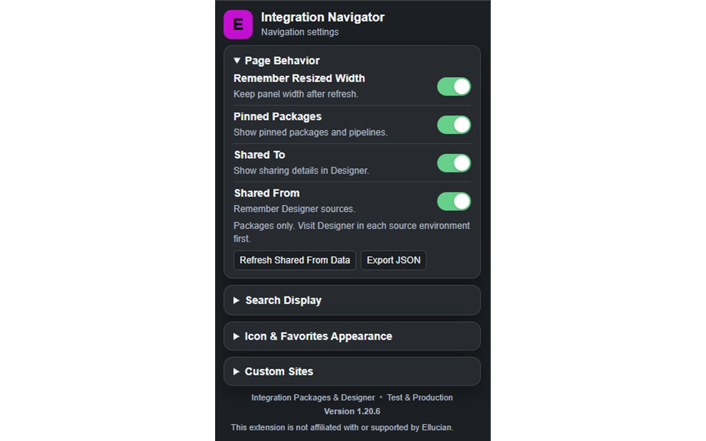

# User Guide

> This is the separate **3.0.8 Git test candidate**, based on v2.1.9. See [Git Export Setup](Git-Export.md) and [v3 Development](V3-Development.md). Configure tokens only in the extension-owned connection tab, never on an Experience page or in a support message. A Git upload requires separate preview and confirmation. ZIP/JSON backups below remain independent; the v2 release build is unchanged. Live Git acceptance is still unverified.

If settings cannot read saved preferences, reopen settings before changing them. Failed search-display saves restore the previous selection and show a message beside that selector. Avoid editing the same favorites list in multiple tabs simultaneously; cross-tab whole-list conflict merging is not included in this repair. This update does not reconstruct previously lost favorites.

## Pipeline Export — v2 Test Candidate

1. Enable Shared From and visit Designer in each source environment to record package/pipeline names.
2. Open Integration Packages, then select **Export → Preview Pipeline Export** in settings.
3. Review the package list. Everything starts checked; use **Select All**, a package checkbox, or expand a package to select individual files/major versions. A partial package selection shows a mixed checkbox and its selected count. The top summary shows selected package/file counts plus Pipeline, Sub-Pipeline, API, and Transformer counts. Every package heading is listed immediately; there is no Show More limit in the exporter.
4. Leave **Formatted** unchecked for the existing package/file layout, or check it for Source/Formatted folders plus a package README.
5. Select **Download ZIP**. After all selected files are collected successfully, the complete archive starts downloading automatically. Your browser may show its usual save prompt. Use **Download Again** afterward only if you need another copy; it rechecks the original source context and reuses the prepared ZIP without fetching sources again. If that page was replaced, closed, or changed environments, reopen export instead.

The ZIP filename and package README use the Shared From environment name saved under the exact current tenant ID, such as integration-navigator-SaaSTest.zip. No extra name lookup is made. If no matching valid name is saved, the verified tenant ID is used instead; visit Designer in that environment to record it. Invalid filename characters are escaped. Names never determine which environment is accessed.

With Formatted checked, each package contains Source/<filename>, Formatted/<filename>, and README.md. Source keeps importable JSON or original JavaScript; Formatted expands escaped whitespace for reading, matching auto-sync's review pass while preserving literal escaped backslashes. Formatted copies are not for import or execution. The package README lists selected names, types, majors, environment, and package-reported versions, not authors or audit history. Unchecked exports add no README or extra folders. Changing Formatted invalidates the old Download Again link; the choice is not stored as a preference.

Both export modes start from Integration Packages; Designer only populates source observations. Default eligibility uses exact saved package/name relationships, not search matching or a live ownership check. Transformer names are recorded separately from pipeline names; older pipeline-only caches do not authorize them. Refresh Shared From in each source Designer after upgrading. Preview requests latest package metadata but no source code. Source reads begin only when you select Download ZIP. Each package gets a folder containing its newest published Pipeline, API, and Sub-Pipeline JSON files and selected published Transformer .js files. JSON content is preserved but formatting may differ; JavaScript response text is saved unchanged and never executed. Transformers resolve through Packages' latest published endpoint; their displayed version comes from package metadata, not independent source-version verification.

For Pipelines and Sub-Pipelines, each available major is independent: export keeps the latest published minor/patch within each major. For example, Name 1.0.4 and Name 2.0.5 appear as separate rows and save as Name_v1.json and Name_v2.json. The major suffix is always present, even for one major; source JSON is unchanged. APIs and transformers still select only the latest overall published version. Each checked major counts separately in the top summary.

Each package heading also shows its selected type counts, such as 2 of 2 selected (Pipelines: 1, APIs: 1). Zero-selected types are omitted. This does not change the expanded list or its checkboxes.

Only checked records are downloaded. Changing the selection removes a previous Download Again link so it cannot save the wrong selection; select Download ZIP again to build the new archive. Normal background-worker sleep does not expire an open preview. Temporary document grants use browser-memory session storage, without source code or credentials. Closing the export tab removes its grant; reloading/updating/disabling the extension or restarting the browser clears that storage. Refreshing/replacing the source Packages document still requires reopening export; it never silently switches to a new document or tenant. Already completed browser downloads are not removed by cancellation or selection changes.

For temporary advanced mode, press **Shift+D** while settings is open and you are not typing. Reveal alone does not enable it: confirm the separate **Include All Accessible Content** warning, then launch export. This bypasses only the saved-source filter, not Ellucian permissions. It is not saved as a preference. Settings resets the choice on close; the launched workflow retains only a temporary memory-session grant until cancelled or closed. It can include vendor-provided content; use it only when authorized to download that content.

Keep the original Packages tab open and on the same tenant until collection finishes. Cancel, navigation, removed eligibility, lost access, timeouts, or mismatched source/version data stop the job without a partial ZIP. Reopen or refresh preview to retry. Sub-Pipelines resolve to the current source within their package-reported major version; preview versions come from package metadata, not the returned JSON. A null/omitted source version is expected and preserved; a supplied version must match the requested major. Pipelines/APIs retain exact full-version requests and mismatch checks. Limits are 10,000 physical files and 64 MB of payload, including generated copies/READMEs, with six native requests at a time.

Downloaded code may contain confidential values embedded in your pipelines. Keep files private and review them before sharing. Export does not modify pipelines, favorites, Shared From data, site access, or JSON backup contents.

[Back to the README](../README.md) · [Troubleshooting](Troubleshooting.md)

## Getting Started

Install [Integration Navigator from the Chrome Web Store](https://chromewebstore.google.com/detail/integration-navigator/dbmjmmgocklhjnadhmibaldicbgoignd) in Chrome or Edge. In Edge, allow extensions from other stores if prompted, then approve the installation. [Microsoft's installation instructions](https://support.microsoft.com/en-us/edge/add-turn-off-or-remove-extensions-in-microsoft-edge) explain this option.

Open Ellucian Experience and go to **Integration Packages** or **Integration Designer**. Select the extension's toolbar icon to open settings. Its installed version appears at the bottom.

## Navigation and Favorites

The package sidebar scrolls independently, keeping its heading visible. Drag its edge to resize it. Enable **Remember Resized Width** to keep the width after refreshing; widths are remembered separately for each supported page and environment.

Use a package's star to pin it. In Integration Packages, you can also pin published pipelines beneath their package. Designer does not offer pipeline stars because its sidebar only lists packages.

- Select a favorite package to open it, or a favorite pipeline to open that pipeline's page.
- Use the arrow to expand or collapse a favorite's pipelines without opening the package.
- Drag handles to reorder packages or pipelines within their package.
- Use a selected star again to unpin an item, including from the favorites area.
- Resize the favorites area vertically, or collapse it when you need more space.

Favorites and their layout stay separate by site, tenant ID, and Packages/Designer page. Multiple tenants on one vanity domain have separate lists. Hiding favorites does not delete them. Unavailable favorites are hidden without deleting their saved pins. Unknown tenant identity cannot load another tenant's favorites.

On upgrade from host-only favorites, old lists carry over automatically to the actual loaded tenant if it is the only tenant known on that domain. Packages and Designer remain separate. Original copies are preserved, and a completed migration never repeats after you remove pins. The first detected tenant is the default; a later tenant gets its own list without inheriting those old favorites. If multiple tenants are already known there, use **Export → Backup & Restore → Use Old Favorites for This Tenant** on the intended page instead. Refresh the page after reloading the extension before testing.

Pipeline favorites follow the newest available release within their pinned **major version**. For example, `1.0.3` follows newer `1.x.x` releases, not `2.x.x`.

## Search and Pipeline Names

The sidebar search finds package and pipeline names. Designer also has a pipeline search inside the selected package, including entries on other table pages.

Designer pipeline search shows the first 20 matches and a count when there are more. Select **Show More** to add the next 20. It searches all loaded entries without additional Ellucian requests.

Search ignores case, spaces, and separators: `MMR`, `unco mmr`, and `uncommr` can all find `UNCO-MMR`.

Enable **Navigation → Integration Packages → Show APIs & Sub-Pipelines** to add a **Type** column and the newest published API release overall and newest Sub-Pipeline minor/patch within each major in Integration Packages. These are plain, non-clickable records without run actions; they are not added to the sidebar or favorites. Normal Integration links work as before. These records use the page's normal package response, not extra network lookups or the Designer cache. **Shared From** remains an independent optional column.

Refresh Integration Packages once after installing this update or re-enabling **Show APIs & Sub-Pipelines**. The page then loads the metadata normally, before its sidebar filters out non-runnable entries. Turning this display setting off removes Type and the extra records and clears their temporary in-memory data, without clearing Designer sources or favorites. Turning Shared From off removes only its source column and cache. Source labels require visiting Designer; API/Sub-Pipeline names do not.

**Pipeline Name** automatically fits each selected package within the space remaining after the other visible columns. Names stay on one line. Drag the divider to adjust it or double-click to fit full loaded names, using local horizontal scrolling if needed. Switching packages calculates a fresh width. With the divider focused, arrow keys resize, Enter fits names, and Home restores automatic sizing.

Clipped favorite names have the browser's native full-name tooltip; fully visible names do not. API/Sub-Pipeline names use the browser's built-in tooltip to show “For Reference Only; Cannot Be Run From This Page.” even when fully visible. This guidance applies only to the name, not the entire row; its delay and presentation are controlled by the browser. Action and sharing help appears after a two-second hover or immediately on keyboard focus. Escape dismisses that custom help.

## Settings

### Task Tabs

Tab names are not repeated as panel headings. Subgroup titles identify distinct content: General/page scope in Navigation, Icon/Favorites in Appearance, and Pipeline Export/Backup & Restore in Export.

The popup has five tabs; only the active panel scrolls, keeping tabs and footer visible.

- **Navigation → General:** width memory, pinned favorites, package sidebar search.
- **Navigation → Integration Packages:** optional API/Sub-Pipeline reference records.
- **Navigation → Integration Designer:** published fitting viewing and selected-package Pipeline Search.
- **Sharing:** Shared To, Shared From, current-Designer cache status, and Refresh Sources.
- **Appearance:** toolbar icon and favorite shape/color choices.
- **Sites:** optional university vanity URLs.
- **Export:** Pipeline Export and independent JSON Backup & Restore.

Sharing features and published fitting viewing remain off by default. Page names in headings/help explain scope. Refresh Sources is grayed out outside Integration Designer or without Shared From consent; Pipeline Export is grayed out outside Integration Packages or without source setup (unless a separately confirmed temporary override applies). A missing page connection keeps page-specific actions unavailable; refresh the page or check site access. These UI checks do not replace operation authorization. Opening settings reads only the active page's existing route/status, not pipeline contents or extra services. Tab choice is not saved.

### Published Fitting Details — Designer

Enable **Navigation → Integration Designer → View Published Fitting Details** to scroll, select, and copy text/code in a published fitting without creating a draft. It is off by default and independent of sharing settings. Code/text remains read-only; checkboxes, dropdowns, reset buttons, and other fitting actions remain disabled. Blanket grey dimming is removed while viewing is enabled; disabled actions still look inactive. Draft editing is unchanged. Switching off or leaving the published fitting restores native UI locks and appearance.

Normal selection and Ctrl+A/Ctrl+C work in supported Ace editors, including a published version that already has a draft. Viewing does not create or change drafts. Editing shortcuts, typing, paste, cut, and drop are blocked. If the existing editor cannot be safely identified, it stays locked; refresh the page and retry, or report the issue without confidential source code. The feature saves only its preference, not fitting contents, and adds no service requests.

### Shared To — Designer

Enable **Shared To** to show destination environments beside published pipelines. Hover or focus a destination to see its newest shared version. Red means that version differs from the published row within the same major version.

Information refreshes when you return from either share flow, even after cancelling. Use the refresh icon beside **Shared To** to recheck the current package view. Hover over the icon for the result, including when no shares are found or a check fails. Completed results are otherwise cached to limit repeated requests; sharing lookups use at most six simultaneous service requests.

Pipelines update individually as their checks finish. Queue waiting does not count toward a service call's 30-second deadline. A timed-out call retains its slot until it actually ends; retries cannot increase traffic beyond six calls. If earlier calls remain stalled, wait or refresh the page before retrying.

### Shared From — Integration Packages

This feature identifies sources from the Designer environments you have visited, rather than reading live share history from Integration Packages.

1. Enable **Shared From** under **Sharing** and accept the local-data notice.
2. Visit Designer in each source environment to collect its package and pipeline names.
3. Return to Integration Packages to see known sources in **Shared From**.

Collection starts automatically after Designer's package data loads, including when entering from Experience Home. Selecting a package is not required.

Unknown or conflicting sources show a dash. Hover or focus the column heading for setup guidance. Information reflects the last successful Designer collection and can become stale; revisit that environment to update it. The extension does not contact all environments from one page.

For a manual retry, open Designer in the source environment and select **Sharing → Refresh Sources** in settings. Setup guidance appears on hover and in the consent notice instead of a permanent extra line. Refresh feedback explains when Designer needs to be opened. It refreshes only that currently open Designer environment. A working circle stays visible until collection and saving finish, or a failure is reported.

In Integration Designer, Sharing shows **Cached MM-DD-YY**, **No Cache**, or **Caching…** for the current environment. The date uses your browser's local time and reflects the last successful save, not a live share check. A failed refresh retains the date and shows its failure separately. **Status Unavailable** means the page connection or environment cannot be identified. Opening settings does not collect more data.

**Export → Backup & Restore → Export JSON** downloads a backup of favorites by site, tenant ID, and page, including pipeline pins, order, and layout. Backup & Restore remains in the final Export tab. Any saved Shared From data is included, grouped by **Environment → Package → Pipelines**, with original last-checked times. Older source names without a recorded package appear under **Package Not Yet Recorded**. It works without cached sources and does not change favorites or settings. Nothing is uploaded; review institution-specific names and identifiers before sharing.

The `favorites` section is the active tenant-specific data. Older recovery copies remain in `unassignedFavorites` until their destination and pins are verified; an `assignedTenantId` there means assignment is known but the copy has not yet been safely retired. Version 1.22.4 removes a duplicate only after reading back the saved tenant list and confirming every old pin is present. Compact `assignments` markers keep that ownership after cleanup, without repeating package/pipeline data. Missing pins or a failed verification keep the copy rather than deleting or silently merging it.

**Export → Backup & Restore → Import JSON** previews the tenant lists before you confirm. Merge keeps existing order and adds missing pins. Replace requires separate confirmation and affects only the matching lists in the file; other tenants are untouched. Current tenant lists take precedence over their older recovery copies. Backups preserve migration associations so pins removed afterward are not revived; older files with one matching current list are handled the same way. Old lists without a corresponding current list follow the upgrade assignment rules on your next visit. **Also Restore Shared From Data** is optional and requires Shared From to be enabled first. Restoring does not change preferences or site permissions, refresh source dates, or replace newer source snapshots with older ones. Older source-only exports are not importable backups. A different site domain does not automatically reuse another domain's favorites.

Turning Shared From off clears only its browser cache, not favorites. Exported files remain separate snapshots and do not update or disappear automatically.

### Search and Reference Display — Navigation

Under **Navigation**, choose **Search Box**, **Icon**, or **Hidden** independently for **Package Sidebar Search** on both pages and **Pipeline Search** inside a selected Designer package. Both default to Search Box. Icon opens search when needed; Escape or clicking elsewhere closes it. Switch tabs to keep unrelated controls out of view.

**Show APIs & Sub-Pipelines** controls reference rows only in Integration Packages. It is off for new installs. Upgrading preserves your previous display choice once; later changes to Shared From do not change this setting. No additional local metadata storage or source-collection consent is needed for reference rows.

### Icon & Favorites — Appearance

Choose the toolbar icon's background, one or two letters, and black or white lettering. The default is a black **E** on purple. Under **Favorites**, choose **Star**, **Circle**, or **Bear**, then a separate color or **Match Icon Color**. All three shapes use your chosen color; unpinned icons remain gray outlines.

The previews reflect your choices. **Reset** restores the toolbar default; **Reset Favorites** restores independent purple stars. Appearance changes leave saved pins, ordering, and expanded packages alone. These settings stay in this browser and do not change the store listing icon. The settings window follows your system's light or dark appearance.

### Custom Sites — Sites

Add your university's HTTPS Experience URL and allow access when prompted, then refresh the page. Setup finishes in the background even if settings close. Custom sites must use the normal Integration Packages/Designer page paths.

Saved custom sites have a **Remove** button. Removing one revokes its optional access; refresh open pages to clear already-loaded controls. Its favorites and widths are retained if you add it again. Adding a different domain does not transfer another domain's favorites or widths. The two standard Experience sites stay enabled.

## Manual Installation

Use this only for a downloaded extension ZIP or a development copy, not a store-installed copy.

1. Extract the extension ZIP into a folder you will keep.
2. Open `chrome://extensions` or `edge://extensions`.
3. Turn on **Developer mode** and select **Load unpacked**.
4. Choose the extracted folder containing `manifest.json`.
5. Refresh any already-open Experience pages.

The extension ZIP has `manifest.json` at its root. If downloading GitHub source instead, extract its outer repository folder and choose the folder containing that file.

To update a manually loaded copy, replace its files in the **same folder**, use its reload button on the browser's extensions page, then refresh Experience. Do not remove and reinstall it to perform a routine update. Store-installed copies use browser-managed updates instead; see [Troubleshooting](Troubleshooting.md#checking-for-store-updates).

## Privacy and Support

Settings, favorites, and optional Shared From sources stay in local browser storage. Shared To makes read-only metadata requests through your existing Ellucian session. The extension does not modify packages or pipelines and has no advertising or analytics. See the [Privacy Policy](../PRIVACY.md) for details.

To uninstall, select **Remove** on the browser's extensions page. Exported JSON files are not removed with the extension.

Support: [moore.life@gmail.com](mailto:moore.life@gmail.com). Please do not send passwords, tokens, student records, or confidential pipeline details.

**Report Bug** beside the settings version opens a public GitHub form. Nothing is attached or uploaded automatically. Include the version, browser, steps, and a short error message or failure code if available. See [checking errors](Troubleshooting.md#checking-errors-and-reporting-a-bug) before sharing console text or screenshots. There is no diagnostic button.

This extension is not affiliated with or supported by Ellucian.
